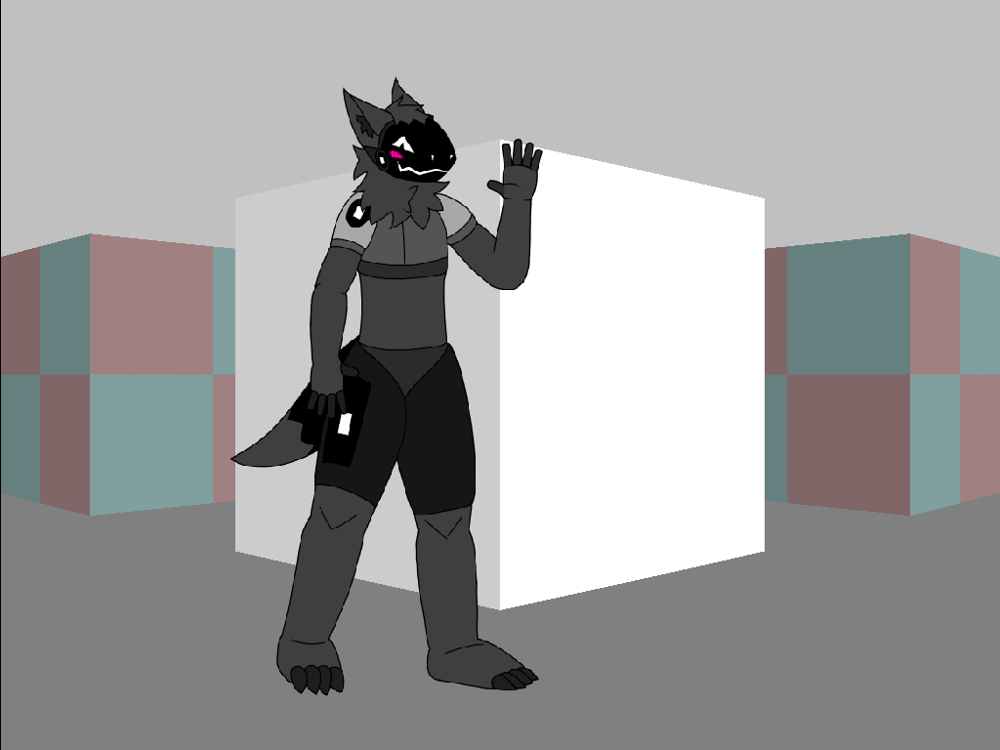

# maze3d

Wolfenstein-style raycaster, maze generator, and maze stepper. Came across demos of similar raycasters on insta reels enough times so I decided to make one.
Supports grid-based block maps and billboarded sprites.

## USAGE

```
	Maze3d maze(16, 16);
	// set up textures. Textures can be a single color or a 2D std::vector representing a texture. Colors are in RGBA uint32_t, largest to smallest. 
	maze.textures[0] = Maze3dTexture(rgb32(255, 0, 0)); // single color texture
	maze.textures[1] = Maze3dTexture(Maze3dTex::animationsingleframe); // vector based image texture
	maze.textures[2] = Maze3dTexture(Maze3dTex::protogen); // another vector based image texture. this one has transparency.

	// id 0 is air, id=ID maps to texture textures[ID - 1]
	maze.cells[10][10] = 1;
	maze.cells[10][12] = 2;
	maze.cells[12][10] = 2;

	// Add a character. This character can be moved around later on by indexing into the characters array.
	maze.characters.push_back(Maze3dCharacter{3, 0.6, 1, {9.5, 9.7}});

	// print the formatted buffer, usable by render.py
	cout << maze.renderBuffer(1024, 1024*3/4, {8.5f, 8.5f}) << endl; 
```

NOTE - Using `a < 255` on the floor, ceiling, or wall textures might have unintended side effects. The `rgb32(uint8_t, uint8_t, uint8_t)` function automatically generates a RGBA color with `a = 255`. Sprites can have alpha, and blending will occur as necessary.

---

 

 